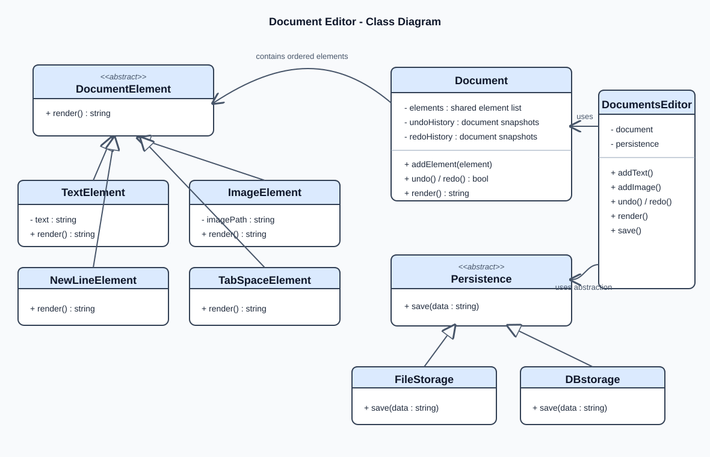
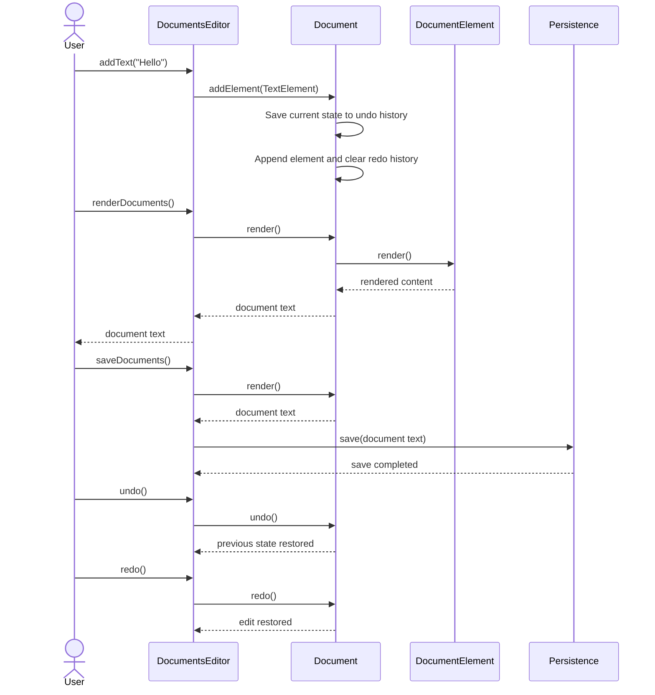

# Google Documents Editor - Low-Level Design

This project is a simple document editor design that models how text, images, spacing, and storage can be organized in a clean object-oriented system.

## System Overview

The design separates responsibilities into four main parts:

- Document content: text, image, newline, tab
- Document composition: combines elements into the final output
- Persistence: handles saving the document in different storage types
- Editor: orchestrates the user actions and rendering flow

## System Diagram

The UML-style class diagram below shows the editor, document model, content elements, persistence abstraction, and undo/redo history.

## Editing Flow (Sequence Diagram)

The sequence below illustrates adding content, rendering and saving it, and then undoing and redoing an edit.

## How this design follows SOLID principles

### 1. Single Responsibility Principle (SRP)
Each class has one clear responsibility:

- TextElement handles only text content
- ImageElement handles image representation
- NewLineElement and TabSpaceElement handle formatting
- Document manages the collection of all content blocks
- Persistence handles saving logic only
- DocumentsEditor handles high-level editor behavior only

This keeps responsibilities isolated and makes future changes easier.

### 2. Open/Closed Principle (OCP)
The system is open for extension but closed for modification.

- New content types can be introduced by creating a new class that extends DocumentElement.
- New storage strategies can be added by creating a new class that extends Persistence.
- Existing classes remain unchanged unless the behavior itself must be modified.

Example: if a future version needs a `TableElement` or `HeadingElement`, it can simply inherit from `DocumentElement`.

### 3. Liskov Substitution Principle (LSP)
Every subclass of `DocumentElement` can replace the parent type without breaking the system.

- `TextElement`, `ImageElement`, `NewLineElement`, and `TabSpaceElement` all implement the same `render()` contract.
- `Document` can safely call `element->render()` on any child object because they all behave like a valid `DocumentElement`.

### 4. Interface Segregation Principle (ISP)
The design avoids forcing classes to implement unnecessary methods.

- `DocumentElement` exposes only the small and relevant contract: `render()`
- `Persistence` exposes only the required `save()` operation
- Classes are not burdened with unrelated behavior

### 5. Dependency Inversion Principle (DIP)
`DocumentsEditor` depends on abstract interfaces instead of concrete implementations.

- It uses `Persistence*` instead of directly depending on `FileStorage` or `DBstorage`
- It works with any storage backend that fulfills the persistence contract
- This makes the editor flexible and testable

## Why this is a good design

### Separation of concerns
The code cleanly separates:

- content representation
- document composition
- persistence
- user-facing editor logic

This prevents one module from becoming responsible for everything.

### Polymorphism
The use of inheritance and virtual methods enables runtime flexibility.

- Different element types can render differently through the same method name
- Different storage implementations can save data in different ways without changing editor code

### Extensibility
Adding new features is straightforward.

Examples:

- Add a `TableElement` to represent table content
- Add a `CloudStorage` class to persist the document remotely
- Add `BoldTextElement` or `ItalicTextElement` for richer formatting

### Maintainability
The project is easy to understand because each class has a small, focused role. This reduces debugging effort and makes future updates simpler.

### Reusability
The `Document` class can be used in multiple editor contexts. The `Persistence` abstraction can be reused with file, database, or cloud storage implementations.

## Design decisions and trade-offs

### 1. Ordered elements and ownership
The document stores elements in order using shared ownership. History snapshots can safely refer to the same immutable content elements while the document changes.

### 2. Using abstraction for persistence
Persistence is represented by an interface. This allows switching between local file storage and database storage without rewriting editor logic.

### 3. Undo and redo
`Document` keeps snapshots of its element list before each edit. Undo moves the current state to redo history and restores the previous state; redo reverses that operation. A new edit after undo clears redo history, matching common editor behavior.

Rendering is performed on demand rather than cached, so the displayed and saved contents always reflect the latest edit, undo, or redo. The snapshots copy the ordered list of shared element references, keeping the elements alive without duplicating their content.

### 4. Composition over complexity
The design uses a simplified document structure instead of an over-engineered framework. This makes the system easier to learn and easier to extend for LLD interviews and classroom assignments.

## Summary

This design is good because it demonstrates a balanced object-oriented architecture:

- clear responsibilities
- reusable abstractions
- extension-friendly design
- easy-to-understand structure
- strong matching with SOLID principles

It is a simple but effective example of a low-level design for a document editor system.

## Possible future enhancements

- Support for `BoldTextElement`, `ItalicTextElement`, and `HeadingElement`
- Multiple storage backends like database, cloud drive, or local file system
- Document versioning and metadata management
- Rich text editor features such as font, size, and alignment
