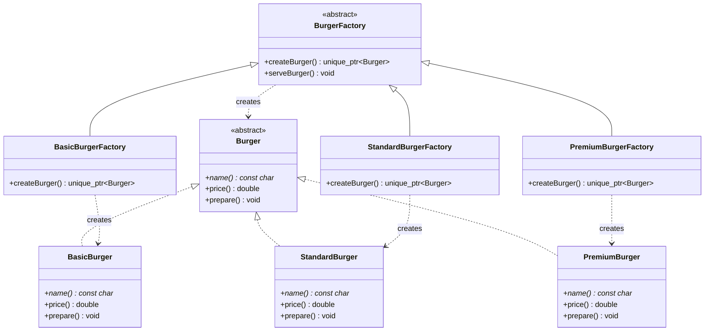
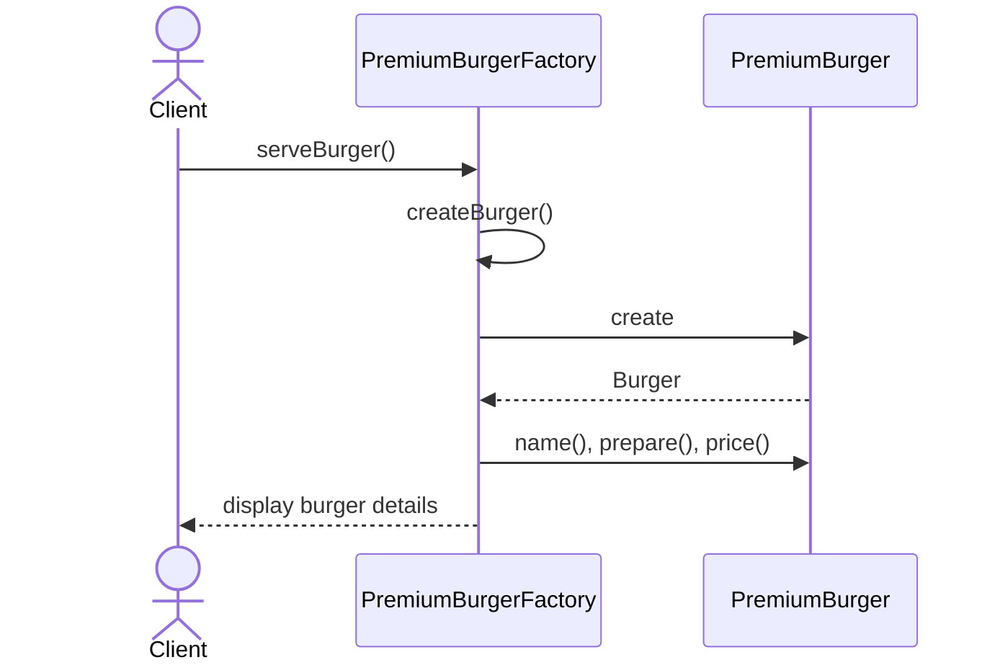

# Factory Method Design Pattern - Burger Shop

This project demonstrates the Factory Method design pattern with a burger shop. The shop can serve a basic, standard, or premium burger without making the client construct concrete burger objects directly.

## System overview

The design has two main abstractions:

- `Burger` defines the common product interface.
- `BurgerFactory` defines a factory method and a shared `serveBurger()` workflow.

Each burger type has a matching factory. The client works with the common factory interface, while each concrete factory decides which burger to create.

## Class diagram



## Order flow

The client calls `serveBurger()` through the factory abstraction. That method calls the factory method; the concrete factory creates the corresponding burger, which is then prepared and priced.



## How to build and run

From this folder, compile with a C++11-compatible compiler:

```sh
g++ -std=c++11 -Wall -Wextra -pedantic BurgerFactory.cpp -o BurgerFactory
```

Run the executable:

```sh
./BurgerFactory
```

On Windows, run `BurgerFactory.exe` after compiling.

## Example output

```text
Factory Method Design Pattern - Burger Shop
--------------------------------------------
Basic Burger
Ingredients: bun, grilled patty, and lettuce
Price: $5.00

Standard Burger
Ingredients: bun, grilled patty, cheese, lettuce, and tomato
Price: $8.50

Premium Burger
Ingredients: brioche bun, double patty, premium cheese, caramelized onions, and signature sauce
Price: $13.00
```

## Why this is the Factory Method pattern

`BurgerFactory::createBurger()` is the factory method. It declares which kind of product is returned without specifying a concrete product. The concrete factories override that method to create `BasicBurger`, `StandardBurger`, or `PremiumBurger`.

The client selects a factory and calls its shared `serveBurger()` operation; it does not contain a `switch` statement or construct burger types itself. The common workflow stays in `BurgerFactory`, while product creation varies by factory.

## Design principles

### Single Responsibility Principle (SRP)

- Each burger class owns its name, price, and preparation details.
- Each concrete factory is responsible for creating one burger type.
- `BurgerFactory` owns the shared serving workflow.

### Open/Closed Principle (OCP)

The design can be extended with another burger by adding a `Burger` implementation and a corresponding `BurgerFactory` implementation. Existing burger and factory classes do not need to be modified.

### Liskov Substitution Principle (LSP)

Every concrete burger can be used through the `Burger` interface, and every concrete factory can be used through the `BurgerFactory` interface.

### Dependency Inversion Principle (DIP)

The serving workflow depends on the `Burger` abstraction, and the client can use the `BurgerFactory` abstraction instead of depending on specific burger classes.

## When to use it

Use Factory Method when a class needs to create products but should leave the concrete product choice to specialized creators. This keeps construction decisions out of client code and makes adding new product types localized to new product and factory classes.
