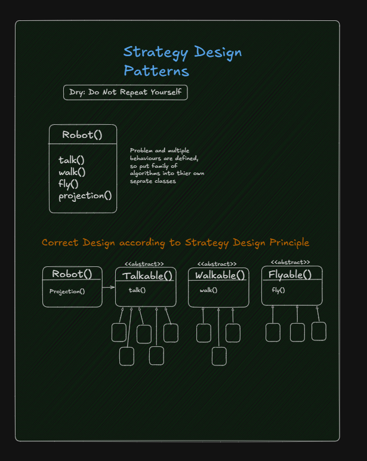
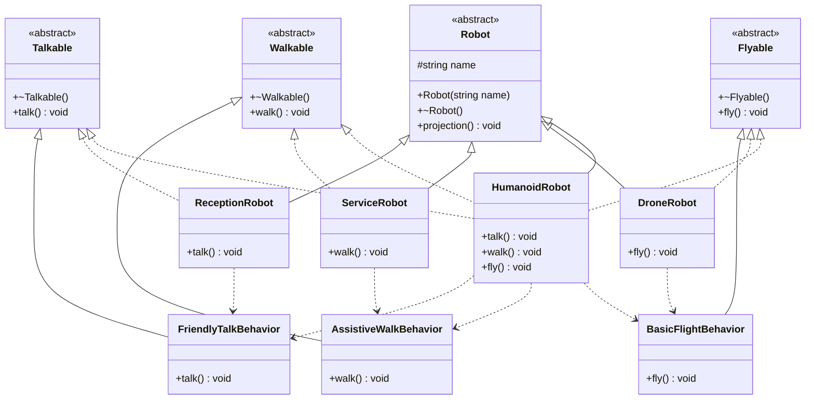
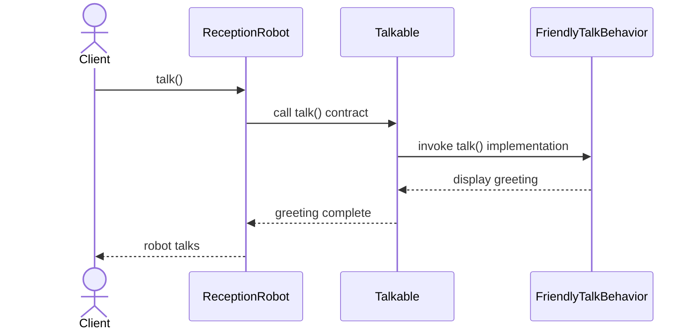

# Strategy Design Principle - Robot Low-Level Design

This project demonstrates the Strategy Design Principle using a robot system. It explains how changing a robot's behavior families can avoid duplicate code and large conditional logic.

## System Overview

The design separates responsibilities into four main parts:

- Common robot identity and projection behavior
- Talking behavior for robots that can communicate
- Walking behavior for robots that can move on the ground
- Flying behavior for robots that can move through the air

## System Diagram

The attached UML-style class diagram shows the `Robot` abstraction, separate capability interfaces, concrete behavior strategies, and concrete robot combinations.





## Behavior Flow

The sequence below shows how a client invokes a capability on a specific robot and how that robot delegates it to the corresponding concrete behavior implementation.



## How this design follows SOLID principles

### 1. Single Responsibility Principle (SRP)
Each class has one clear responsibility:

- `Robot` manages common robot identity and projection
- `Talkable`, `Walkable`, and `Flyable` declare capability contracts
- `FriendlyTalkBehavior` implements only talking behavior
- `AssistiveWalkBehavior` implements only walking behavior
- `BasicFlightBehavior` implements only flying behavior
- Concrete robots combine only the capabilities they require

### 2. Open/Closed Principle (OCP)
The system is open for extension but closed for modification.

- A new talking, walking, or flying algorithm can be introduced by implementing the relevant interface
- A new robot can inherit `Robot` and compose the required interfaces
- Existing robot classes do not need to change when a new behavior is added

Example: if a walking robot needs a different movement algorithm, a new `ClimbingWalkBehavior` can be created without changing `ServiceRobot`.

### 3. Liskov Substitution Principle (LSP)
Any concrete behavior object can replace another implementation of the same interface without violating the behavior contract.

- Every `Talkable` implementation provides `talk()`
- Every `Walkable` implementation provides `walk()`
- Every `Flyable` implementation provides `fly()`
- A client can depend on the abstract capability rather than a specific implementation

### 4. Interface Segregation Principle (ISP)
The design does not force every robot to implement unrelated behaviors.

- `ReceptionRobot` implements only `Talkable`
- `ServiceRobot` implements only `Walkable`
- `DroneRobot` implements only `Flyable`
- `HumanoidRobot` implements only the three capabilities it supports

### 5. Dependency Inversion Principle (DIP)
Concrete robot types depend on capability abstractions instead of depending directly on unrelated base behavior.

- `ReceptionRobot` works with the `Talkable` contract
- `ServiceRobot` works with the `Walkable` contract
- `DroneRobot` works with the `Flyable` contract
- High-level robot code can use capability interfaces instead of fixed concrete algorithms

## Strategy selection

The behavior for each robot can be selected independently:

| Robot | Talkable | Walkable | Flyable |
|---|---|---|---|
| `ReceptionRobot` | Yes | No | No |
| `ServiceRobot` | No | Yes | No |
| `DroneRobot` | No | No | Yes |
| `HumanoidRobot` | Yes | Yes | Yes |

This composition keeps the robot hierarchy small and makes new combinations possible without creating a new base class for every possible capability set.

## Why this is a good design

### Separation of concerns
The design cleanly separates:

- common robot identity
- capability contracts
- concrete behavior algorithms
- concrete robot combinations

### Reuse
A behavior implementation can be shared by multiple robot types. For example, `FriendlyTalkBehavior` can be reused by `ReceptionRobot`, `HumanoidRobot`, and any future talking robot.

### Avoiding conditional logic
Without strategies, code such as a long `if/else` or `switch` block would decide the behavior of every robot type. This design moves each behavior into a separate implementation and lets the object use only the capabilities it supports.

### Runtime flexibility
Different behavior implementations can be assigned to a robot without changing the shared robot interface.

### Extensibility
Adding a new capability is straightforward:

- Create a new abstract capability interface
- Create one or more concrete strategies
- Implement the interface in the robot types that support it

Examples include `Swimmable`, `Climbable`, or `Chargeable` behavior.

## Design decisions and trade-offs

### 1. Composition over one large interface
The original `Robot` interface should not expose `talk()`, `walk()`, and `fly()` to every robot. A robot that cannot perform a behavior would otherwise be forced to provide an irrelevant implementation. Separate capability interfaces avoid this problem.

### 2. Concrete behavior reuse
The strategy classes contain behavior families that can be reused across robots. A robot with a different algorithm can implement or choose another strategy without changing the capability contract.

### 3. Multiple inheritance for capability composition
Each concrete robot inherits from `Robot` plus only the capability interfaces it supports. C++ multiple inheritance is used here to express capability composition; the interfaces contain virtual behavior contracts and do not introduce an overlapping implementation hierarchy.

### 4. Simple example scope
The example uses interface implementations with direct behavior calls. A complete system could store behavior pointers and allow runtime strategy changes, but that would add additional indirection not needed to demonstrate the core principle.

## Compile and run

```powershell
g++ -std=c++17 -Wall -Wextra -pedantic .\StrategyPattern.cpp -o .\StrategyPattern.exe
.\StrategyPattern.exe
```

Expected result includes the projection of each robot, followed by the behavior supported by `ReceptionRobot`, `ServiceRobot`, `DroneRobot`, and `HumanoidRobot`.

## Summary

This design is a simple but effective example of the Strategy Design Principle:

- capability responsibilities are separated
- unrelated robots are not forced to implement unwanted methods
- behavior implementations can be reused
- new strategies can be added without changing existing code
- concrete robots can combine independent capabilities

## Possible future enhancements

- Store strategy pointers inside `Robot` objects for runtime behavior replacement
- Add `Swimmable`, `Climbable`, and `Chargeable` capabilities
- Add no-operation strategies for optional robot capabilities
- Introduce a robot factory for centralized object creation
- Add unit tests for every behavior combination
